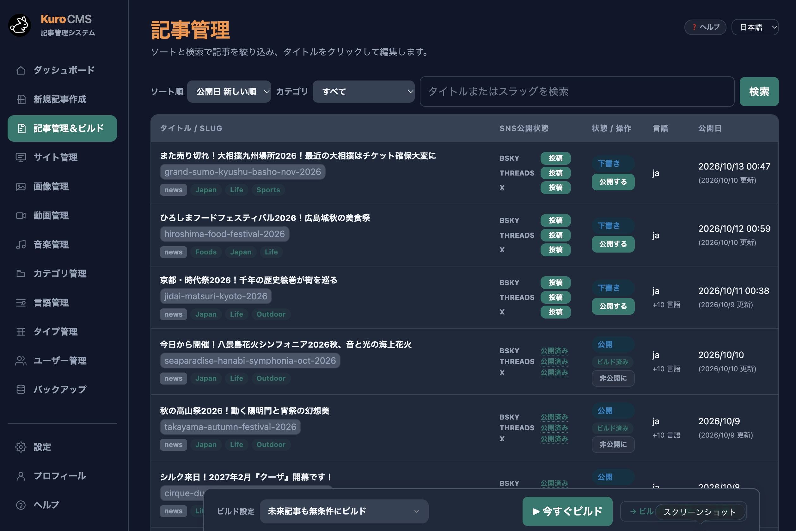

# 🐰 KuroCMS 2.0

**The Cloudflare-native headless CMS — multilingual sites at the edge, free on your own Cloudflare account.**

[**🚀 Install**](https://kurocms.entamy.com/) ・ [**📖 Read the story (EN)**](https://kuro.boo/blog/kurocms-003/?lang=en) ・ [**🏷️ Versions**](https://github.com/Kuro-Boo/KuroCMS/tags) ・ [**🔒 Security**](./SECURITY.md)

> KuroCMS admin · article management — languages, per‑article SNS status, and one‑click build.

KuroCMS runs **entirely on Cloudflare** (Workers, D1, KV and R2). You write in the admin,
KuroCMS builds your public pages, and Cloudflare serves them from the edge. There is no
server or database to look after.

## ✨ Features

- ✍️ **Writing** — rich editor (KuroEditor), autosave, revision history, cover images, categories, hashtags and scheduled publishing.
- 🌐 **Multilingual** — one article with a translation per language, a URL per language, and right‑to‑left language support.
- 🎨 **Site design** — community templates, direct HTML editing, per‑language site text, web fonts and GA4.
- 🖼️ **Media** — images, video and audio, with optional automatic image downsizing.
- ⚡ **Build and publish** — manual builds, or automatic builds for scheduled and published posts.
- 📣 **Social** — post articles to Bluesky, X and Threads, and track what was posted per article.
- 🤖 **REST API and MCP** — JSON endpoints, plus an MCP server at `/api/mcp` so AI tools can create, update, publish and build content. Both authenticate with a PAT.
- 🔐 **No passwords** — admin sign‑in uses passkeys (WebAuthn), with email recovery. Optional IP restriction.
- 👥 **Team and data** — invite admins and authors, and back up or restore the whole site as one ZIP.

## 🚀 Get started

### → [Open the web installer at kurocms.entamy.com](https://kurocms.entamy.com/)

Installation runs in the browser, with no CLI or build. Choose where the site runs:

- **Your own Cloudflare account** — free. A typical site fits within Cloudflare's free plan.
  Media storage needs R2 enabled on your account.
- **Hosted by Entamy** — paid, with the first 3 months free.

You can move a site between the two later, from its admin.

## 🛠️ Tech stack

- **Runtime**: [Cloudflare Workers](https://workers.cloudflare.com/)
- **Database**: [Cloudflare D1](https://developers.cloudflare.com/d1/)
- **Storage**: Cloudflare KV (rendered pages) and R2 (media)
- **Language**: TypeScript, with no framework and no third‑party npm packages in the Worker

Each install has its own Worker, D1 database and KV namespaces. Updates and recovery are
handled by a separate Worker (WorkerOps), so a failed update can be rolled back even if
KuroCMS itself can't start.

## 📦 About this repository

This repository publishes the **core source code of KuroCMS for transparency**, so anyone
can review what the software does. **You don't build or deploy from here** — use the web
installer above.

| Path | Contents |
|---|---|
| `src/` | Cloudflare Worker source (the CMS itself, without the Entamy platform connection) |
| `migrations/` | D1 database schema migrations |

Each stable version is marked with a [tag](https://github.com/Kuro-Boo/KuroCMS/tags). Built
releases are signed and distributed from `update.entamy.com`, not from this repository. Build
tooling, configuration and maintainer scripts are intentionally omitted.

## 🔄 Updates

The admin Dashboard shows the installed and stable versions, and installs updates with one
click or automatically.

## 🔒 Security

Found a vulnerability? Please see [SECURITY.md](./SECURITY.md) for private reporting
instructions. Do not file public issues for security problems.

## ⚖️ License

KuroCMS is licensed under the **Kuro License** (an MIT‑based license with an
attribution requirement).

> When the Software is used to provide a public‑facing or user‑facing interface, the phrase
> **“with KuroCMS”** must be shown in an appropriate attribution area.

See [LICENSE.txt](./LICENSE.txt) for the full text.

The Kuro License covers the source code in this repository. The release builds
(`worker.js` from `update.entamy.com`) also contain the code that connects KuroCMS to the
Entamy platform (Entamy ID, hosting, updates and contracts). That code is not part of this
repository and is not covered by the Kuro License, so this repository cannot be built on
its own. Using Entamy services such as Entamy ID or hosting
by Entamy is governed by the Entamy Terms of Service and Privacy Policy, which you
agree to inside the app.
